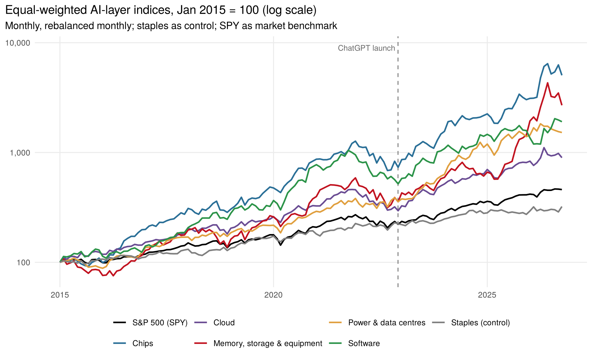
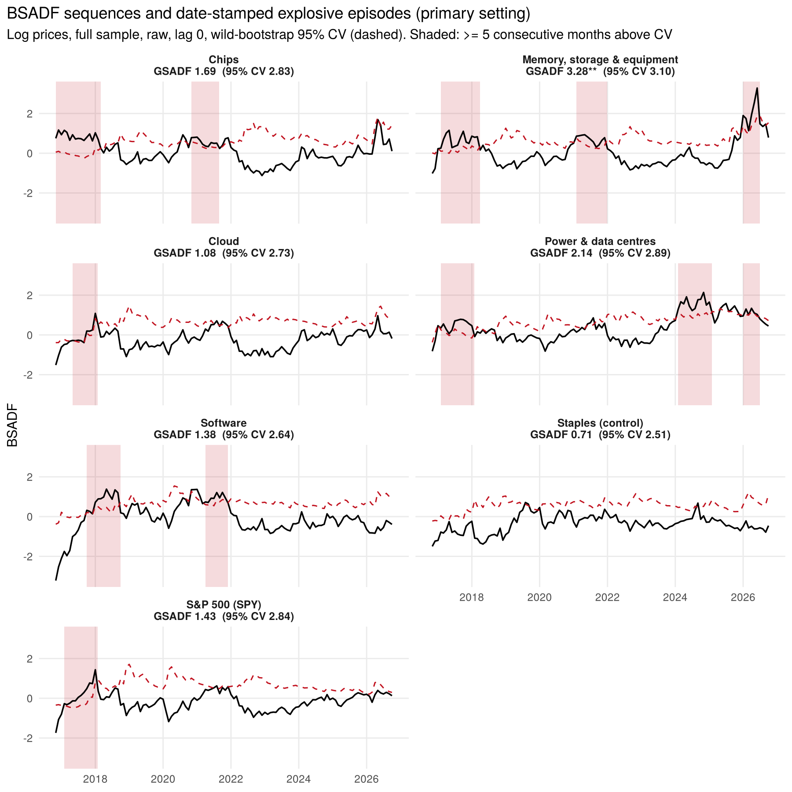
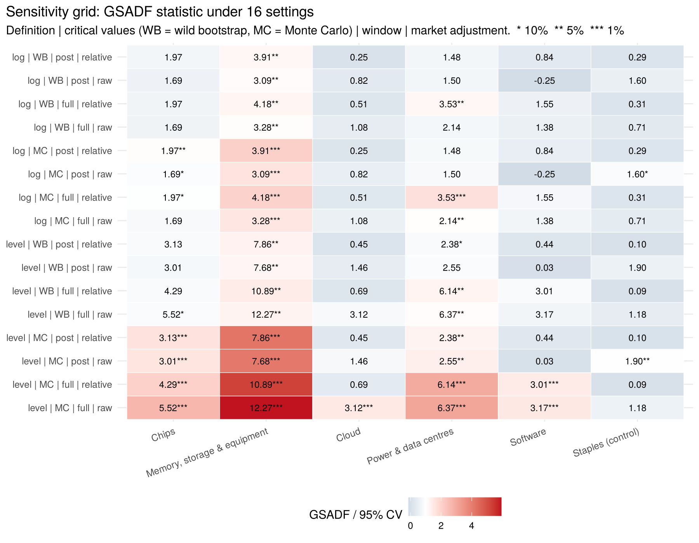
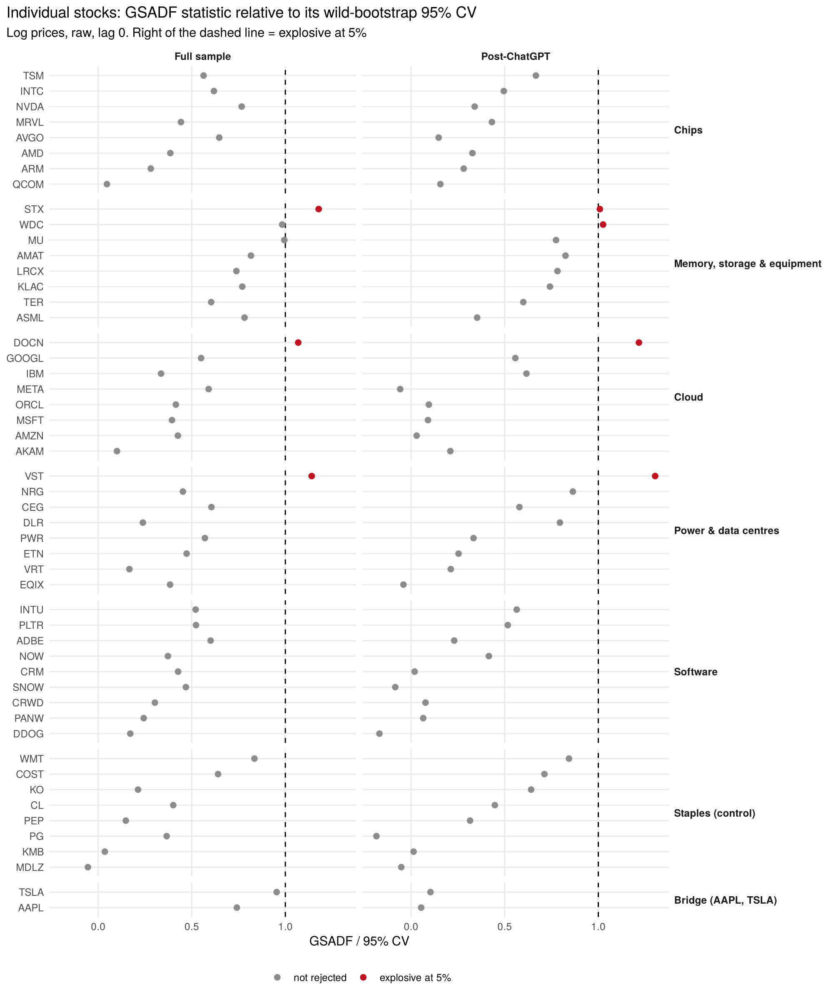
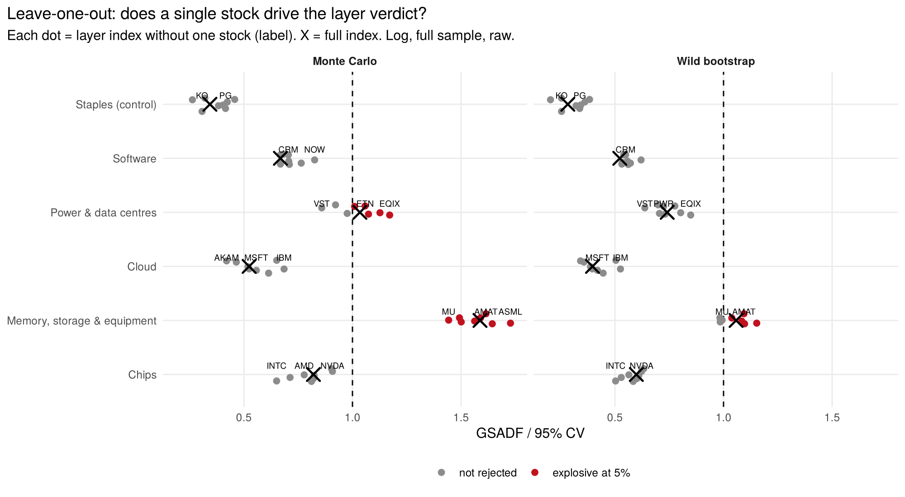
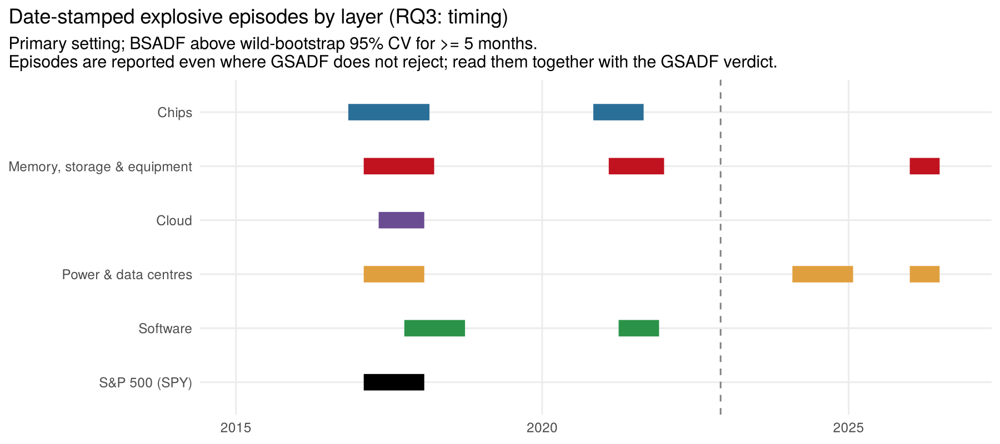

# Where in the AI stack is the exuberance? — Findings

*Mogos Michele · Shori Divya · TSAF F2026 · data: Yahoo Finance adjusted prices, Jan 2015 – Oct 2026, monthly (T = 142)*

> All numbers are produced by the scripts in `R/` and stored in `output/tables/`. Stars: \* 10%, \*\* 5%, \*\*\* 1%.
> Primary setting = log prices · full sample · raw (not market-adjusted) · ADF lag 0 · wild-bootstrap 95% critical value.

---

## 0. Data and index construction

- **Universe.** 49 US-listed stocks in five AI layers plus a consumer-staples control (8–9 per layer). Constituents, role (core / laggard / control) and selection rationale: `data/constituents.csv`. First month each stock enters its index: `output/tables/constituents_appendix.csv`.
- **Equal-weighted indices.** Equal-weighted monthly simple returns, rebalanced monthly, rebased to 100 at end-January 2015. A stock enters from its first *full* month of trading. The index needs ≥ 4 priced constituents.
- **Coverage check (passed).** Every layer has ≥ 4 stocks from the sample start: chips 7, memory/equipment 8, cloud 7, power & DC 5, software 5, staples 8 (`coverage.csv`).
- **Concentration check.** No single stock accounts for more than a third of any AI layer's cumulative arithmetic return (`contributions.csv`):
  - Full sample: the largest share is 22% (AMD in chips; NVDA is nearly identical).
  - Post-ChatGPT: the most concentrated layers are software (PLTR 32%) and power & DC (VRT 28%).
  - Memory/equipment is the least concentrated AI layer (MU 15–19%).

## 1. Baseline: standard ADF (lecture 1)

- Log prices of every AI layer and of SPY have a unit root (trend ADF does not reject at 5%). Log returns are stationary (τ between −7.6 and −10.9).
- Staples are trend-stationary at 5% (τ = −3.62).
- Residuals of the lag-0 Dickey–Fuller regression show **no serial correlation** (Ljung–Box p > 0.3, except staples at p ≈ 0.04). They do show **strong ARCH effects** in chips, memory/equipment, power & DC and SPY (p < 0.001).
- Two consequences: lag 0 is adequate, with lag 1 as a check; and heteroskedasticity-robust (wild-bootstrap) critical values should be the primary choice.

## 2. Main result — index-level GSADF and date-stamping (RQ1)

| Layer | GSADF | 95% CV (wild bootstrap) | 95% CV (Monte Carlo) | Verdict (WB) | Date-stamped episodes (WB, ≥ 5 months) |
|---|---|---|---|---|---|
| Chips | 1.69 | 2.83 | 2.07 | not explosive | 2016-11→2018-02, 2020-11→2021-08 |
| **Memory, storage & equipment** | **3.28** | **3.10** | 2.07 | **explosive \*\*** | 2017-02→2018-03, 2021-02→2021-12, **2026-01→2026-06** |
| Cloud | 1.08 | 2.73 | 2.07 | not explosive | 2017-05→2018-01 |
| Power & data centres | 2.14 | 2.89 | 2.07 | not explosive (\*\* with MC) | 2017-02→2018-01, 2024-02→2025-01, 2026-01→2026-06 |
| Software | 1.38 | 2.64 | 2.07 | not explosive | 2017-10→2018-09, 2021-04→2021-11 |
| Staples (control) | 0.71 | 2.51 | 2.07 | not explosive ✔ | none |
| S&P 500 (SPY) | 1.43 | 2.84 | 2.07 | not explosive | 2017-02→2018-01 |

ETF cross-check (wild bootstrap): SMH 1.80 (CV 2.79), IGV 0.98 (2.57), SKYY 0.95 (2.87), XLP 0.16 (2.60). None reject, which matches the hand-built chips, software, cloud and staples indices.

**Reading.**
- Only memory, storage & equipment rejects the no-bubble null under the primary setting. Its latest episode runs Jan–Jun 2026, the HBM/storage rally in which MU rose roughly 3.4× between March and June 2026.
- The 2017 episodes appear in almost every series, *including SPY*. They reflect the low-volatility market-wide rally of 2017, not AI. With market adjustment (relative to SPY) they disappear for every layer except chips (see section 3).
- Date-stamped episodes in series whose GSADF test does not reject are *not* evidence of a bubble. BSADF is compared with a pointwise critical-value sequence, so short excursions above it occur by chance.

## 3. Sensitivity grid (RQ2): 16 settings per layer

| Layer | Settings rejecting at 5% | Pattern |
|---|---|---|
| **Memory, storage & equipment** | **16 / 16** | rejects under every definition, critical value, window and adjustment |
| Power & data centres | 9 / 16 | all four level + MC cells, both level + WB full-window cells, and log full-window cells that are market-adjusted or use MC |
| Chips | 5 / 16 | only with Monte Carlo CVs: all four level cells plus log · post · relative |
| Software | 2 / 16 | only levels + Monte Carlo, full window |
| Cloud | 1 / 16 | only levels + Monte Carlo + full + raw |
| Staples (control) | 1 / 16 | levels + Monte Carlo + post + raw → **false alarm** |

**Lag 1.** Verdicts are unchanged: memory 3.13 vs CV 3.10 (\*\*), power & DC rises to 2.57 (\* at 10%), staples stays quiet.

**What drives the verdict.** In order of influence:
1. **Critical values.** Monte Carlo CVs (2.07 at T = 142) are much lower than the series-specific wild-bootstrap CVs (2.5–3.2). The simulation (section 6) shows Monte Carlo CVs reject a bubble-free random walk up to 29% of the time when volatility shifts, which is the case here (ARCH effects, section 1).
2. **Definition.** Price levels flag steady compounding. In the full window, every AI layer has a level-based GSADF above 3 (memory 12.3), versus 1.1–3.3 in logs.
3. **Window and market adjustment** matter less. Market adjustment *strengthens* the memory and power verdicts (4.18 and 3.53 in logs), so their explosiveness is not just the market rising.

## 4. Is it one stock or the whole segment? (lecturer robustness check)

**(a) Every constituent tested individually** (log, raw, wild bootstrap; each stock on its own sample with its own PSY window):

| Layer | Explosive at 5%, full sample | Explosive at 5%, post-ChatGPT |
|---|---|---|
| Chips | 0 / 8 | 0 / 8 |
| Memory, storage & equipment | 1 / 8 (STX; MU at 10%) | 2 / 8 (WDC, STX) |
| Cloud | 1 / 8 (DOCN) | 1 / 8 (DOCN) |
| Power & data centres | 1 / 8 (VST) | 1 / 8 (VST) |
| Software | 0 / 9 | 0 / 9 |
| Staples | 0 / 8 | 0 / 8 |

**(b) Leave-one-out indices:**
- **Memory/equipment.**
  - Wild bootstrap: the rejection survives dropping any equipment name (AMAT, LRCX, KLAC, ASML, TER). It falls just below the 5% CV when *any one* of MU, WDC or STX is dropped (still significant at 10%).
  - Monte Carlo: every leave-one-out index rejects at 1%.
- **Power & data centres** (Monte Carlo): the rejection depends on VST, VRT and CEG. Dropping any one of them lowers it to 10%.

**Interpretation.**
- Exuberance in memory/equipment is concentrated in the **memory and storage sub-segment (MU, WDC, STX)**, not in one firm and not in equipment makers.
- Aggregation does not mask explosive behaviour here. It *reveals* it: the three storage names are individually borderline, but their co-movement gives the index a cleaner explosive signal than any one of them.
- In cloud, by contrast, an individually explosive small cap (DOCN) is diluted by the hyperscalers. That is the case the lecturer warned about: aggregation can hide single-stock exuberance.
- Power & DC sits in between: three AI-power names (VST, VRT, CEG) carry a weak layer-level signal.

## 5. Replication bridge: Nvidia and the Magnificent Seven

| Setting | NVDA | Bridge stocks flagged at 5% (of 12) |
|---|---|---|
| Monthly · log · wild bootstrap | 1.86 (CV 2.43) — no | 0 (MU and TSLA at 10%) |
| Monthly · log · Monte Carlo | 1.86\* (CV 2.07) — 10% only | 2 (MU, TSLA) |
| Weekly · log · Monte Carlo | 1.61 (CV 2.24) — no | 2 (MU, TSLA; AMD at 10%) |
| Monthly · level · wild bootstrap | 6.92\*\* (CV 6.37) — **yes** | 4 (NVDA, AAPL, TSLA, PLTR) |
| Monthly · level · Monte Carlo | 6.92\*\*\* — **yes** | **12 / 12** |
| Weekly · level · Monte Carlo | 9.07\*\*\* — **yes** | **12 / 12** |

- The published "Nvidia is exuberant" result is reproduced **only on price levels**. On levels with Monte Carlo CVs, every bridge stock, MSFT, GOOGL and AMZN included, is flagged. That setting therefore cannot tell a bubble apart from fast compounding growth.
- On log prices, which flag acceleration of the *growth rate*, NVDA's 2015–2026 path is not explosive at monthly or weekly frequency.
- Remaining difference from the published study: it uses daily data and a different sample end. We document this rather than claim a contradiction.

## 6. Validation by simulation: size and power

200 simulated series per cell, PSY minimum window, 95% critical values (`simulation_size_power.csv`).

| DGP | T | Rejection rate, Monte Carlo CV | Rejection rate, wild bootstrap CV | Bubble dated inside true episode |
|---|---|---|---|---|
| Random walk, constant volatility (size) | 142 / 47 | 7.5% / 3.0% | 2.5% / 2.0% | — |
| Random walk, GARCH(1,1) errors (size) | 142 / 47 | 7.5% / 7.5% | 2.0% / 1.0% | — |
| Random walk, volatility ×3 in 2nd half (size) | 142 / 47 | **28.5% / 21.5%** | 7.0% / 3.5% | — |
| PSY single bubble (power) | 142 / 47 | 77% / 82% | 65% / 44% | 75% / 62% |

**Implications.**
- **Monte Carlo CVs are unreliable** when volatility shifts: a bubble-free random walk is "explosive" up to 29% of the time. Our series have strong ARCH effects, so Monte Carlo rejections that the wild bootstrap does not confirm (chips, software, cloud, most of power & DC) should be treated as likely false alarms.
- **The wild bootstrap holds size** (≤ 7%) but is conservative and has limited power. At T = 47 it detects a textbook bubble less than half the time. A *non*-rejection in the post-ChatGPT window is therefore weak evidence of no bubble.
- **The rejections we do find**, for memory/storage, under the wild bootstrap and in both windows, are the credible ones.
- Date-stamping placed the simulated bubble inside the true episode in 75% of runs at T = 142, so the pipeline works end to end (validation step "simulated bubble and random walks": passed).

## 7. Timing (RQ3, exploratory)

Post-ChatGPT episodes, log prices, wild bootstrap (monthly) and weekly Monte Carlo:

1. **Power & data centres goes first.** Relative to the S&P 500 it is explosive from Aug 2023 to Jan 2025 (full window) and Dec 2023 to May 2024 (post window). Weekly episodes cluster in Feb–May 2024 and Sep 2024 – Jan 2025.
2. **Memory, storage & equipment follows**, from Nov 2025 / Jan 2026 to Jun 2026, with peak prices in June 2026. Weekly: Jan–Feb 2026 and Apr–Aug 2026.
3. **Chips appears only briefly**, at weekly frequency in May–Jun 2026, alongside memory.
4. **Cloud and software:** no post-2022 episode in any monthly log setting.

The sequence runs from the physical bottlenecks first (power, then memory) to compute last. Cloud platforms and application software, where AI revenue is meant to accrue, stay out of it. This is a descriptive ordering; with T = 47 post-2022 months its statistical precision is limited (section 6).

## 8. Answers to the research questions

- **RQ1 (Where).** Exuberance is neither a Nvidia story nor chain-wide. The only robustly explosive layer is **memory, storage & equipment**, driven jointly by the memory/storage names (MU, WDC, STX). Power & data centres shows weaker, setting-dependent exuberance concentrated in AI-power names (VST, VRT, CEG). Chips, cloud and software are not explosive in log prices.
- **RQ2 (Robustness).** The memory verdict is robust to all 16 settings and to lag choice. Everything else depends heavily on (i) the critical values and (ii) log versus level. Level-based tests with Monte Carlo CVs flag every growth stock and even the staples control once, so they are not a credible definition of "explosive" for these data.
- **RQ3 (Timing).** Power & data centres (2023–25) → memory/storage (late 2025–mid 2026) → chips briefly (mid 2026).
- **Expectations.**
  - E1 (layers differ): confirmed.
  - E2 (staples not flagged): confirmed except one weak cell.
  - E3 (definition matters): strongly confirmed.
  - E4 (verdict driven by few stocks): partly. Memory is driven by a *sub-segment* of three names; power & DC by three AI-power names.

## 9. Limitations

- **Survivorship and hindsight.** Yahoo data omit delisted firms. Laggards are included and leave-one-out is reported, but the stock lists are chosen with knowledge of 2026.
- **Multiple testing.** 96 grid cells plus 100+ stock tests. We interpret patterns across settings, not single cells.
- **Power.** The post-ChatGPT window has T = 47, where the wild bootstrap detects a simulated bubble only 44% of the time (section 6).
- **Simulation bootstrap.** The simulation uses a lean re-implementation of exuber's wild bootstrap for speed (matching its CVs up to bootstrap noise). All empirical results use exuber itself.
- **Frequency.** Weekly results use Monte Carlo CVs only. The wild bootstrap at T ≈ 618 was computationally impractical, as anticipated in the feasibility study.
